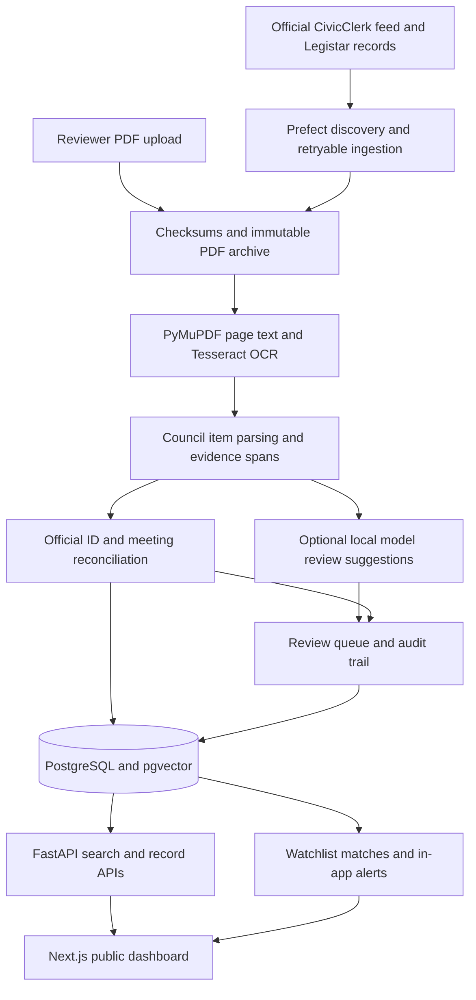

# CivicLens

CivicLens is an independent civic information application for Hattiesburg, Mississippi. It is not an official government website. Search a local proposal, trace it through official minutes, follow it from a watchlist, and review the exact PDF pages supporting a recorded outcome.

The demo uses six official PDFs from three City Council meetings. Search **2026-749** for the Jaycee Park roof proposal and the recorded 5–0 vote, **2026-827** for the FY 2027 budget, or **2019-025** for the Spencer Street historic landmark item. Search **2026-757** for an example that still needs item-level verification. [September 8 agenda](https://hattiesburgms.api.civicclerk.com/v1/Meetings/GetMeetingFileStream(fileId=4556,plainText=false)) · [September 8 minutes](https://hattiesburgms.api.civicclerk.com/v1/Meetings/GetMeetingFileStream(fileId=4623,plainText=false)) · [January 2019 meeting](https://hattiesburgms.legistar.com/MeetingDetail.aspx?GUID=79BB73AB-68B9-4536-8377-CC04C4B0E56B&ID=669983&Search=)

## Run with Docker Compose

Requires Docker with Compose v2, working access to the official records, and ports 3000, 8000, and 4200 available.

```sh
cp .env.example .env
docker compose up -d --build
docker compose run --rm -e PREFECT_API_URL=http://prefect:4200/api api civiclens bootstrap
```

- [Dashboard](http://localhost:3000)
- [FastAPI documentation](http://localhost:8000/docs)
- [Prefect](http://localhost:4200)

Bootstrap fetches real documents rather than loading application fixtures. The Prefect worker refreshes the recent and upcoming meeting window every six hours. Populate that window immediately with:

```sh
docker compose run --rm -e PREFECT_API_URL=http://prefect:4200/api api civiclens sync
```

Backfill a half-open range of Hattiesburg dates:

```sh
docker compose run --rm -e PREFECT_API_URL=http://prefect:4200/api api civiclens backfill 2026-09-01 2026-10-01
```

## Run without Docker

Use Python 3.11+, Node 22+, and Tesseract English language data for OCR. SQLite provides the local keyword-search path. PostgreSQL and pgvector provide the production search path.

```sh
python -m venv .venv
# On macOS/Linux, activate with: source .venv/bin/activate
# On Windows PowerShell, activate with: .\.venv\Scripts\Activate.ps1
python -m pip install -e ".[test]"
alembic upgrade head
civiclens bootstrap
uvicorn civiclens.api:app --host 127.0.0.1 --port 8000
```

In another terminal:

```sh
npm ci --prefix web
npm run dev --prefix web
```

For a named local API port or a separate deployment, set `API_INTERNAL_URL` before starting or building Next.js. Put `ADMIN_TOKEN` in the root `.env` to enable the reviewer sign-in. The API and CLI load that file from the repository root. For Windows hosts whose application-control policy blocks Whenever's optional native extension, install the corresponding upstream pure-Python wheel as described in the [deployment guide](docs/deployment.md).

## Evidence and revisions

- An agenda makes a proposal searchable. A completed meeting without specific authoritative evidence remains **Outcome not yet verified**.
- Each observation stores the original PDF checksum, physical page number, exact character offsets into the stored page text, and the extraction version. The timeline retains prior revisions and their archived PDFs.
- The parser recognizes explicit council motion and disposition wording. Group votes, imperfect text, ambiguous official identifiers, and contradictory records can require reviewer action.
- Amounts describe values mentioned in the source passage. A dollar figure in an agenda can be an estimate, a contract total, a change, or a proposed award. The cited language is the basis for interpreting the amount.
- Watchlists use a browser-scoped identity and an in-app inbox. Residents can pause a watch, follow a particular item, unsubscribe, or delete their data.

## How the system fits together



The Python service is a modular monolith. The Prefect worker uses the same models and processing entry points as the API. PostgreSQL handles item state and alert uniqueness. There is no separate Redis queue.

## Sources and coverage

| Source | CivicLens use |
| --- | --- |
| [Hattiesburg City Council](https://www.hattiesburgms.com/council/) | Official council information and historical archive attribution |
| [CivicClerk public portal](https://hattiesburgms.portal.civicclerk.com/) | Public meeting metadata and published PDF links. The worker uses the tenant's unauthenticated OData Events endpoint. |
| [Legistar calendar](https://hattiesburgms.legistar.com/Calendar.aspx) | Legacy records. The default calendar returned no meetings for the current view when checked. The bootstrap uses a verified historical meeting page and its agenda and final minutes. |
| [City public-notice landing page](https://www.hattiesburgms.com/public-notice-signs/) | City directs readers to meeting-related agendas. The CivicClerk adapter handles PDFs published with a notice type. |

See [source contract](docs/sources.md) for publisher details and the demonstration document inventory.

## Tests and reference evaluation

```sh
python -m pytest -q
npm run typecheck --prefix web
npm run build --prefix web
# With the API and web app running after bootstrap:
cd web
npx playwright install chromium
npm run test:e2e
```

The OCR test uses Tesseract when installed. The PostgreSQL test uses `CIVICLENS_PG_TEST_URL` and a disposable database. A source-backed test uses `CIVICLENS_REAL_PDFS` with the downloaded January 2019 agenda and minutes named `669983-agenda.pdf` and `669983-minutes.pdf`. Browser CI bootstraps from real source PDFs.

The [reference evaluation](evaluation/README.md) reviewed 17 items across four July and August PDFs outside the demo. The current deterministic pipeline confirmed 5 of 14 labeled dispositions with zero incorrect confirmations in that sample. All five displayed vote tallies and decision PDF pages matched the labels. The evaluation also reports financial extraction, evidence offsets, search ranking, and observed processing time.

## Deployment and limits

[Deployment guide](docs/deployment.md) covers secrets, PostgreSQL, the optional local LLM and embedding model, public PDF imports, backups, and review. Structured parsing is strongest on numbered City Council items. Documents with other layouts are retained and flagged for review. Coverage depends on what the city publishes. The dashboard shows the latest meeting for which records have been processed.

Code is licensed under [MIT](LICENSE). Source records remain attributable to the City of Hattiesburg and its official publishers. PDFs and user data are stored locally and are excluded from Git.
